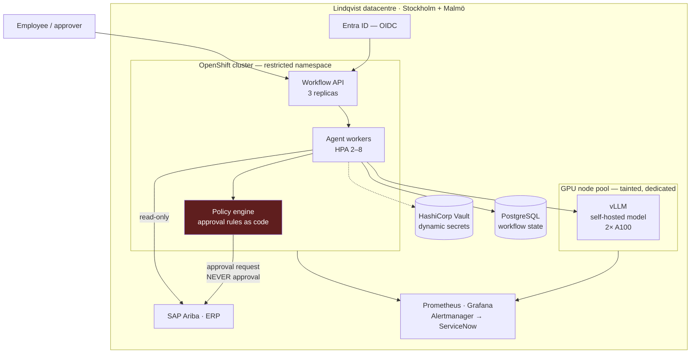

# Customer Deployment & Operational Readiness Review

**Customer:** Lindqvist Group — Nordic industrial manufacturer, €8.2B revenue,
42,000 employees, 14 countries.
**System:** AI workflow automation for internal request handling — purchase
requisitions, supplier onboarding, and access requests. Classifies, enriches,
routes to the correct approver, and drafts the approval record.
**Deployment:** customer-owned infrastructure, on-premises Kubernetes.

---

## The constraint that defines this deployment

Lindqvist requires private infrastructure and permits **no outbound internet
traffic from the application tier**. For an AI system that normally calls a
hosted model, that is not a configuration detail — it removes the usual
architecture entirely.

**The model is therefore self-hosted inside the customer's datacentre.** That
resolves data residency, removes the need for a vendor DPA, and takes the
egress exception off the table. It also transfers three new responsibilities to
the customer: GPU capacity planning, model serving availability, and the model
upgrade lifecycle. **That trade is the single most consequential decision in
this review**, and it is made because the constraint forces it, not because
self-hosting is better.

---

## 1 · Deployment architecture



**Deployment model: single-tenant, customer-operated, vendor-supported for 60
days.** Three options were considered:

| Model | Why not |
|---|---|
| Vendor SaaS | fails the private-infrastructure requirement outright |
| Customer cloud account | Lindqvist's cloud footprint is Azure-only and the GPU quota is committed to an existing programme |
| **On-prem Kubernetes** | **selected** — existing OpenShift platform, existing GPU nodes, existing operational tooling |

The decisive factor is not technical. Lindqvist already runs OpenShift,
Prometheus, Vault and ServiceNow, with teams who operate them. **Deploying into
tooling the customer already knows is worth more than deploying into tooling we
prefer** — it is the difference between a system they can own on day 61 and one
they cannot.

---

## 2 · Customer constraints

| # | Constraint | Consequence for the design |
|---|---|---|
| **Infrastructure** |
| C1 | On-prem only; no public cloud for this workload | self-hosted model; no managed services |
| C2 | GPU capacity is fixed — 2× A100, shared | model size bounded; queueing, not autoscaling, absorbs peaks |
| C3 | Two datacentres, active/standby not active/active | RTO 4h, not minutes |
| **Security** |
| C4 | No outbound internet from the application tier | internal mirrors for images and packages |
| C5 | All identities from Entra ID; no local accounts | OIDC everywhere; no static kubeconfigs |
| C6 | Secrets in Vault; no static credentials at rest | dynamic database credentials, 1h TTL |
| C7 | Data stays in the EU | satisfied by construction |
| **Operational** |
| C8 | Changes via the CAB; emergency changes need post-hoc review | release cadence is fortnightly, not continuous |
| C9 | Architecture Review Board sign-off before production | design documents are a deliverable, not a courtesy |
| C10 | Customer owns operations after 60 days | handover is the deliverable, not a phase |
| C11 | **Segregation of duties under internal audit policy** | see §3 — the most important control here |
| C12 | Works council consultation for anything affecting roles | timeline dependency, started in week 1 |

**C11 is the constraint that most shapes behaviour.** Lindqvist's audit policy
requires that no single identity can both initiate and approve a financial
commitment. An AI system that routes *and* approves requisitions would breach
that policy and create a fraud path. The architecture is built so the agent
**cannot** approve: it prepares, enriches and routes. A human identity approves,
and the ERP enforces that independently.

---

## 3 · IAM strategy

Identity flows from Entra ID throughout. Nothing in this system has a password.

| Identity | Type | Can do | Explicitly cannot |
|---|---|---|---|
| Employee | Entra user | raise a request | approve their own |
| Approver | Entra user + group | approve within delegated authority | approve above their limit |
| `wf-agent` | K8s service account, workload identity | read ERP master data, write draft records, call the model | **approve anything**; write to financial postings |
| `wf-api` | service account | accept requests, read workflow state | call the model directly |
| `wf-deploy` | pipeline identity, OIDC | deploy to the namespace | read Vault application secrets |
| `wf-breakglass` | named humans, PIM-elevated | inspect, restart, exec | read secrets; alter approval records |

### Least privilege, concretely

**Kubernetes:** a dedicated namespace with a restricted Pod Security Standard.
Role bindings scoped to that namespace; no ClusterRole for the workload. Network
policies default-deny, with explicit egress to Vault, Postgres, the model
service and the ERP gateway — and nothing else.

**ERP:** the agent holds a **read-mostly** service principal. It may read
supplier and cost-centre master data and write *draft* requisitions. It has no
authorisation object for posting or releasing. This is enforced in SAP's own
authorisation model, not in our code — a control the customer's auditors
already know how to test matters more than one we invent.

**Segregation of duties, enforced in three places:**

1. The agent's ERP principal lacks the release authorisation. Technical.
2. The policy engine refuses to emit an approval, only an approval *request*.
   Code.
3. The ERP independently rejects an approval whose approver equals the
   requester. Independent.

**Three layers, because one is a configuration change away from being none.**
The third is the one that still holds if someone widens the first two.

**Break-glass** uses Entra PIM: time-boxed to 2 hours, requires MFA and a
justification, and is reviewed monthly against ServiceNow incidents. A session
with no matching ticket is an audit finding.

---

## 4 · Secrets management

**HashiCorp Vault**, which Lindqvist already runs. Workloads authenticate with
the Kubernetes auth method — the pod's service account token is exchanged for a
Vault token bound to that namespace and service account.

| Secret | Type | TTL |
|---|---|---|
| Postgres credentials | **dynamic** — generated per pod | 1 hour, auto-renewed |
| ERP service principal | static, Vault-stored | rotated 90 days |
| TLS certificates | cert-manager via internal PKI | 90 days, automatic |
| Model weights checksum | config, not secret | n/a |

Four properties that make this defensible:

- **No secret in git, in a manifest, or in an image.** Vault Agent injects at
  pod start.
- **Database credentials are dynamic** — one per pod, expiring hourly. A
  credential leaked from a log is useless tomorrow, and it identifies *which
  pod* leaked it.
- **No Kubernetes `Secret` objects** for application credentials: they are
  base64, not encrypted, and readable by anyone with namespace `get`.
- **Deploy and break-glass identities cannot read application secrets.**
  Pipeline logs are widely readable.

**There is no model API key**, because the model is self-hosted. The highest-
value credential in a typical AI deployment does not exist in this one — which
is the clearest security benefit of the on-prem trade.

---

## 5 · Operational readiness

Into Lindqvist's existing stack: Prometheus, Grafana, Alertmanager, ServiceNow.
Nothing new to learn and nothing new to operate.

### SLOs

| SLI | SLO | Why this one |
|---|---|---|
| Request classification success | ≥ 99.5% | the core function |
| p95 end-to-end routing latency | ≤ 8s | approvers abandon beyond ~10s |
| Correct-approver routing rate | **≥ 97%** | misrouting is invisible to RED metrics |
| Model service availability | ≥ 99.5% | shared GPU; the likeliest outage |
| Zero unauthorised approvals | **100%** | audit; no error budget |

### Alerting

| Signal | Severity | Routes to |
|---|---|---|
| Error rate > 2%, 10 min | P2 | platform on-call |
| p95 > 8s, 2 periods | P3 | platform on-call |
| Model service unavailable | P2 | platform on-call |
| GPU queue depth > 50 | P3 | platform on-call |
| **Routing-mix shift > 15% from baseline** | **P2** | platform + process owner |
| **Any approval emitted by a non-human identity** | **P1** | security + internal audit |
| Vault auth failure | P2 | platform + security |

Two are unusual and deliberate. **Routing-mix shift** catches a silent
behavioural regression — the system still answers every request, nothing
errors, and it routes to the wrong approvers. No RED metric moves.
**Approval by a non-human identity** should be impossible by design, which is
exactly why it is alarmed: a control that cannot fail does not need monitoring
only if you are certain, and nobody should be.

### Support model

| Phase | Duration | Who |
|---|---|---|
| Hypercare | weeks 1–2 | vendor leads, customer shadows |
| Transition | weeks 3–8 | **customer leads, vendor shadows** |
| Supported | weeks 9–12 | customer owns; vendor on call for design questions |
| Independent | week 13+ | customer only |

The reversal at week 3 is the point. A customer who has not run an incident
before the vendor leaves has not taken ownership — they have taken delivery.

---

## 6 · Runbook design

Contents, in the order someone paged at 03:00 needs them:

| § | Contents |
|---|---|
| 0 | **First 60 seconds** — three commands: is it running, what is it saying, what changed |
| 1 | Access — how to elevate via PIM, with the justification format |
| 2 | Architecture in one page — data flow and dependencies |
| 3 | Deploy — pipeline, the CAB reference, manual fallback |
| 4 | **Rollback** — procedure, target time, and *what rollback does not undo* |
| 5 | Symptom index — symptom → cause → action, as a table |
| 6 | Model service — GPU exhaustion, queue depth, OOM, restart |
| 7 | Secrets — Vault auth failures, rotation, lease expiry |
| 8 | Data — Postgres failover, stuck workflows, replay |
| 9 | **Security events** — stop, preserve, escalate; containment without destroying evidence |
| 10 | Routine — weekly, monthly, quarterly, with the DR test |
| 11 | Escalation — four levels, named, with the date vendor support ends |

Three principles. **Every alert names a section** — one without a runbook link
is a page beginning "what does this mean?". **§4 states what rollback does not
undo**: reverting a deployment does not un-route a requisition, so the runbook
carries the query that finds what was actioned during the bad window. **§9 says
contain, do not clean up** — scale to zero rather than delete, because the logs
and database state are the investigation.

---

## 7 · Knowledge transfer plan

**Test it must pass:** an engineer who has never seen this system takes it from
a page to a resolved incident, and from a ticket to a deployed change, using
only the repository.

| Session | Exit test — the customer does it, we watch |
|---|---|
| 1 · Architecture | they draw the data flow and name where SoD is enforced |
| 2 · Deploy & rollback | **they deploy and roll back unaided** |
| 3 · Runbook drill | they resolve 4 injected faults from the runbook alone |
| 4 · Security review | their security team signs off IAM and secrets design |
| 5 · Change walkthrough | **they ship a real change end to end** |
| 6 · DR exercise | they rebuild in the standby datacentre |

**Sessions 2, 3, 5 and 6 are exercises, not presentations.** A handover where
the vendor does the typing demonstrates nothing, and documentation gaps surface
only when someone else follows the instructions.

Fault injection for session 3: expire a Vault lease · exhaust GPU memory ·
point the image tag at a missing tag · widen a routing rule so the mix shifts
15%. The last is hardest — every RED metric stays green.

**Ownership is recorded by name, not by team alias**, for each of the eight
components. An unowned component is one nobody patches.

---

## 8 · Productization opportunity

**The policy-as-code approval engine.**

Lindqvist's requirement — *no identity may both initiate and approve a
financial commitment* — is not specific to Lindqvist. Every enterprise
deploying workflow automation has an equivalent rule, usually written in a
policy document and enforced nowhere.

The engine encodes approval authority as versioned, testable rules:

```yaml
rule: requisition_approval
  requires:
    - approver.id != requester.id            # segregation of duties
    - amount <= approver.delegated_authority
    - approver.cost_centre == request.cost_centre
  emits: approval_request                     # never an approval
  audit: { decision, rule_version, inputs, timestamp }
```

**Why it generalises:** the pattern — *the automation prepares, a human decides,
and the system can only emit a request* — is the control that makes AI
acceptable in any approval workflow. The next customer's audit conversation then
starts from a tested artefact rather than a promise.

**Productise the engine, not the rules.** Rules are customer-specific; the
engine is not — versioned rules, a test harness, an audit record per decision,
and the structural guarantee that it cannot emit an approval. ~3 weeks.

**What not to reuse:** the agent itself. It encodes Lindqvist's ERP,
cost-centre model and approval hierarchy, and would cost the next customer a
week of deletion.

---

## 9 · Risk assessment

### Operational

| Risk | Impact | Likelihood | Mitigation |
|---|---|---|---|
| **GPU capacity contention** with the existing programme | High | **High** | dedicated tainted node pool; queue depth alarm; agreed priority in writing |
| Model service is a single point of failure | High | Medium | 2 replicas across both DCs; graceful degradation to manual routing |
| CAB cadence blocks urgent fixes | Medium | High | pre-approved emergency change class, agreed before go-live |
| Customer cannot operate at day 61 | **High** | Medium | exercises not presentations; week-8 readiness gate with a defined fail action |
| Silent routing regression | High | Medium | routing-mix alarm; **no RED metric moves** |
| Model upgrade breaks behaviour | Medium | Medium | pinned version; evaluation suite gates the upgrade |

### Security

| Risk | Impact | Likelihood | Mitigation |
|---|---|---|---|
| **Agent used to obtain an unauthorised approval** | **Critical** | Low | three independent SoD controls (§3); P1 alarm; audit review |
| Prompt injection via request free-text | High | Medium | input sanitisation; **the real control is that the agent cannot approve** |
| Credential leak from a pod | Medium | Low | dynamic 1h credentials; leak identifies the pod |
| Over-broad namespace access | Medium | Medium | restricted PSS; default-deny network policy; quarterly access review |
| Insider use of break-glass | High | Low | PIM, MFA, justification, monthly review against tickets |
| Supply chain via internal mirror | Medium | Low | signed images; admission control rejects unsigned |

**The two that decide this engagement are GPU contention and day-61 readiness.**
Neither is technical. The first is a capacity negotiation with another
programme, which is why it is agreed in writing before build. The second is why
the handover is structured as exercises with a gate rather than as training
with a feedback form.

**On prompt injection:** sanitisation reduces the probability that a crafted
request reaches the model with bad instructions. It does not eliminate it, and
claiming otherwise would be dishonest. What bounds the outcome is that the
agent has no authorisation to approve anything — so the worst case is a
misrouted request, not an unauthorised commitment. **Probability controls and
consequence controls are different things, and only the second survives an
attacker who is cleverer than your filters.**
